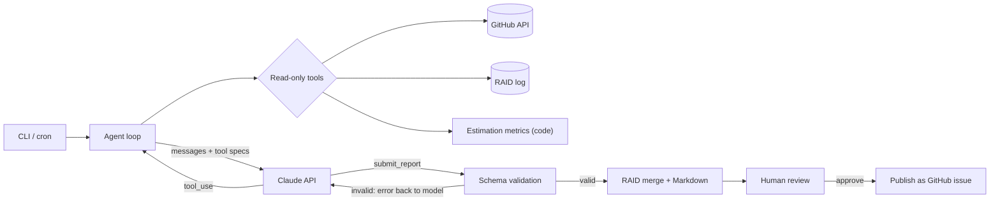

# Delivery Radar

**An AI agent for Delivery Managers.** It does the evidence-gathering part of the weekly delivery cycle: investigates GitHub repositories, compares the plan with what actually shipped, keeps a RAID log across runs and drafts a status report for human review.

Built on the Claude API with plain tool use: no agent framework, every step visible, testable and auditable.

---

## Why

Weekly status is usually assembled by hand from commits, pull requests, tickets and roadmap documents. It takes time, it is easy to miss what did *not* happen, and risks surface late.

Delivery Radar automates the investigation and keeps the human accountable for the conclusions:

- **Risks early**: idle pull requests, stale issues, overdue milestones, one-person bus factor, plan-versus-actual drift, operational debt mentioned in docs.
- **Evidence for every claim**: each item cites a commit, PR/issue number or file.
- **Accountability over time**: RAID items keep stable IDs from week to week and close only with evidence.
- **Estimation data captured**: coverage, estimate-vs-actual ratio and cycle time, computed in code.

## What it produces

| File | Content |
|---|---|
| `reports/YYYY-MM-DD-status.md` | Weekly status: RAG, summary, completed / in progress with evidence, next steps, RAID, decisions needed, estimation & flow, learnings |
| `reports/raid.json` | Persistent RAID log (Risks `R-`, Assumptions `A-`, Issues `I-`, Dependencies `D-`) with first seen / last seen / closed dates |
| `reports/YYYY-MM-DD-run.json` | Audit trail: every tool call, token usage and the structured report |
| `reports/latest.md` | Copy of the latest report |

See a [sample report](examples/sample-report.md) (synthetic data).

## How it works



1. The CLI builds the tool set for the configured repositories and starts the loop with a system prompt that defines the analyst's job and rules.
2. Claude decides which tools to call: it reads the previous RAID log, then commits, PRs, issues, milestones and planning docs for each repository.
3. Tool results go back to the model, slimmed to the signal (age, staleness, author counts), until it calls `submit_report`.
4. The report is validated against a schema. If evidence or fields are missing, the error goes back to the model, which fixes and resubmits.
5. The RAID log is merged and saved, and the report is rendered to Markdown.
6. Publishing to GitHub happens only after a person reads the report and types `y`.

### Tools

| Tool | Purpose |
|---|---|
| `list_repositories` | In-scope repositories and metadata |
| `get_raid_log` | RAID items from previous runs (to keep IDs stable) |
| `list_commits` | Commits in the period, with counts per author |
| `list_pull_requests` | Open PRs plus those updated in the period, with age and idle days |
| `list_issues` | Issues updated in the period plus all open issues, with staleness |
| `list_milestones` | Due dates, progress, overdue flag |
| `list_files` / `read_file` | Planning docs: ROADMAP, docs/, runbooks, CHANGELOG |
| `estimation_stats` | Deterministic estimation and flow metrics |
| `submit_report` | Structured final report (terminal tool) |

### Guardrails

- **Read-only agent.** None of the agent's tools can write. Publishing is a separate CLI step behind interactive human approval; it is refused in non-interactive runs such as cron.
- **Scope enforcement.** Tools reject any repository outside the configured list.
- **Evidence or it didn't happen.** The schema requires evidence for every completed item and RAID entry.
- **Numbers come from code.** Metrics are computed deterministically; the model interprets them and is told not to invent any.
- **Prompt-injection hygiene.** Repository content is treated as data, not as instructions.
- **Bounded cost.** Step budget, truncated tool outputs, token usage logged per run.

## Estimation conventions

Add estimates and actuals as issue labels or as a line in the issue body:

```
estimate: 4h      est: 2d      estimate: 1w
actual: 6h        spent: 1.5d
```

Units: `h` hours, `d` = 8h, `w` = 40h. Without this data the report says so and recommends how to start capturing it.

## Quick start

Requires Node.js 18.17+.

```bash
git clone https://github.com/spangroup/delivery-radar.git
cd delivery-radar
npm install
cp .env.example .env        # add ANTHROPIC_API_KEY, GITHUB_TOKEN, RADAR_REPOS

npm run dry-run             # checks GitHub access and data, no LLM call
npm start                   # generates the report into ./reports
npm start -- --repo owner/name --since 14
npm start -- --publish owner/name   # review, then approve posting as an issue
```

**GitHub token:** a fine-grained personal access token limited to the target repositories, with read-only *Metadata, Contents, Issues, Pull requests*. Grant *Issues: write* only if you use `--publish`.

### Run weekly

```cron
30 7 * * 1 cd /opt/delivery-radar && mkdir -p reports && /usr/bin/env node src/cli.js >> reports/cron.log 2>&1
```

See [`deploy/cron.example`](deploy/cron.example).

## Tests

```bash
npm test
```

18 tests, no network or API keys needed:

- agent loop with scripted model responses: tool results round-trip, invalid report is rejected and corrected, tool errors are returned to the model, step budget is enforced;
- RAID log persistence and stable IDs across runs;
- estimation parsing and metrics;
- GitHub client URL building, path-traversal guard and token handling;
- end-to-end CLI run (dry run and full run) against local mock GitHub and Claude APIs.

## Project layout

```
src/
  cli.js         entry point, config, dry run, human-approved publish
  agent.js       the tool-use loop
  tools.js       read-only tools and the report schema
  prompts.js     system prompt and task prompt
  github.js      minimal GitHub REST client
  raid.js        persistent RAID log
  estimation.js  deterministic estimation and flow metrics
  validate.js    report validation
  render.js      Markdown rendering
test/            node:test suite with fakes and an end-to-end CLI test
```

## Roadmap

- GitLab and Jira sources
- Report delivery to Slack or Telegram after approval
- Week-over-week trends (RAID burn-down, estimate accuracy)
- Portfolio view across several projects

## How this was built

In an AI-native workflow: the problem, scope and acceptance criteria come from my own delivery work; design and implementation were done with Claude as the coding agent, then reviewed and accepted against the test suite.

## Author

**Ihor Stolyarchuk**, Technical Delivery Manager · [LinkedIn](https://www.linkedin.com/in/igor-stolyarchuk-77846a1a4)

MIT License
